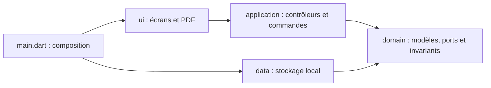

# Architecture TradeFlow

## Organisation et sens des dépendances

- **`lib/domain/`** contient du Dart indépendant de Flutter et du stockage : entités, projections documentaires, calculs de pilotage, filtres, validation des instantanés et interfaces de dépôts.
- **`lib/application/`** orchestre les actions et publie les changements avec `ChangeNotifier`. Cette couche dépend du domaine et de `flutter/foundation.dart`, sans importer les widgets ou les adaptateurs de stockage.
- **`lib/data/`** implémente les ports avec SharedPreferences et la sérialisation JSON. Aucun écran n’importe directement ces adaptateurs.
- **`lib/ui/`** organise les écrans par fonctionnalité. La mise en page PDF et les services de présentation/partage y appartiennent également.
- **`lib/main.dart`** compose les adaptateurs, les contrôleurs et l’application. Il traite aussi l’échec initial d’accès au stockage.

Les tests d’architecture vérifient les imports et exports directs à chaque exécution de la suite. Ils interdisent les dépendances inversées et les imports entre fichiers d’entrée de tests. Ils ne constituent pas un contrôle de permissions utilisateur.

## Modèles et point d’entrée stable

`lib/domain/models.dart` reste le point d’entrée des entités, pour conserver les imports des fonctionnalités. Il réexporte désormais des fichiers cohérents : produit, partenaire, commande, stock et agrégat `TradeData` dans `domain/entities/`. Les modèles commerciaux, documents et suivis restent dans leurs fichiers dédiés.

Le format des sauvegardes et les noms de champs ne changent pas. Les versions 1 et 2 restent lisibles. Les anciens mouvements sans identifiant ou quantités avant/après sont conservés ; les anciennes livraisons sans date ne reçoivent pas d’événement fictif. Les anciens partenaires portant le même nom gardent leurs identifiants distincts.

## Contrôleur et commandes par fonctionnalité

Le noyau `application/trade_store.dart` gère état chargé/occupé, lecture, validation et publication après sauvegarde. Les commandes sont réparties dans les fichiers `*_operations.dart` : catalogue, stock/inventaires, partenaires, ventes, devis, achats, livraison/retours et documents.

Ces fichiers sont des parties de la même bibliothèque Dart, sous forme d’extensions sur `TradeStore`. Ils partagent une seule porte de sauvegarde privée et les contrôles communs. Les appels des écrans restent `store.addProduct(...)`, `store.receivePurchase(...)`, etc. Les dépôts et l’état mutable des contrôleurs sont privés ; les écrans observent des getters et utilisent les commandes prévues.

`application/shopping_session.dart` contient le parcours public encore simulé. Il expose ses états en lecture seule et utilise le port de panier. `application/product_catalog.dart` adapte les produits publiés en catalogue observable. Les exemples locaux sont isolés dans `application/demo_data.dart` ; leur chargement conserve l’entreprise, les catégories et les unités configurées.

## Ports de stockage

Les interfaces `TradeRepository` et `PublicCartRepository` appartiennent à `domain/repositories.dart`. Les implémentations locales restent dans `data/` et sont injectées aux contrôleurs par le point de composition.

Le port métier transporte actuellement un instantané complet. Il ne fournit pas à lui seul des transactions multi-utilisateurs ou un verrou entre onglets. Un futur adaptateur Firebase devra traiter les permissions, transactions et conflits côté serveur ; remplacer simplement la lecture/écriture locale ne suffira pas.

## Intégrité et échecs

`domain/snapshot_validation.dart` vérifie les invariants de l’agrégat avant de l’exposer ou de le sauvegarder : identifiants uniques, références connues, stocks et compteurs bornés, liens devis/commandes, quantités livrées/reçues/retournées, événements, inventaires et sources des archives.

Au chargement, l’instantané candidat est validé avant de remplacer le dernier état valide. Une lecture incohérente bloque les écritures et conserve les données précédentes ; aucune réinitialisation automatique n’est effectuée. Les validations ne réécrivent pas les noms et unités historiques.

À la sauvegarde, le nouvel état n’est publié qu’après une écriture rapportée comme réussie par le dépôt. SharedPreferences modifie son cache avant de terminer l’écriture plateforme : les adaptateurs rechargent donc le stockage après un échec et avant chaque lecture. Une valeur non persistée ne doit pas réapparaître par le seul cache local.

Ces garanties ne transforment pas SharedPreferences en base transactionnelle durable ou synchronisée. Le stockage reste local, limité et dépourvu d’archivage externe. Les accès concurrents entre processus ou appareils nécessitent le travail serveur prévu dans [FIREBASE.md](FIREBASE.md).

## Cycle de vie

`ShoppingHost` possède uniquement les sessions qu’il crée. Les sessions injectées restent la propriété de leur appelant. Un remplacement de magasin ou de session détache l’ancien catalogue et ses écouteurs avant de rattacher le nouveau. Une révision de portée force le rafraîchissement du panier même si la session et son widget enfant restent identiques. Les notifications nécessaires pendant ce remplacement sont délivrées par les widgets hérités, sans notification déclenchée pendant leur construction.

## Tests et évolution

Les fakes, données commerciales et aides de navigation sont dans `test/support/`, indépendamment des fichiers `*_test.dart`. Les tests couvrent métier, persistance, migrations, démarrage, cycle de vie, interfaces, PDF et architecture. Les seuils mesurés et commandes de validation sont décrits dans [QUALITY.md](QUALITY.md).

Les prochaines étapes structurantes restent l’authentification réelle, les transactions serveur, la synchronisation, les entrepôts multiples et les finances. Les profils de démonstration ne servent pas à autoriser les opérations du backend.
